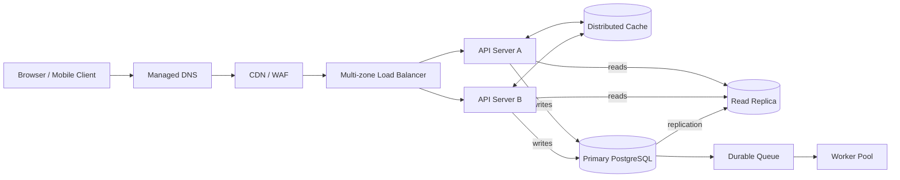

# QuickNotes Service Architecture

## Requirements

**Functional:** users can register and authenticate; create, list, read, update, and delete their notes; organize notes with tags; and page/search their own notes. The API enforces ownership and validates all input.

**Non-functional:** target 99.9% monthly availability; keep common note reads under 200 ms at p95; encrypt traffic and stored data; isolate each user's data; scale stateless API capacity horizontally; back up data and support recovery; and observe latency, errors, saturation, and queue lag.

## Capacity estimate: 1 million registered users

Assumptions: 20% of registered users are active daily (200,000 DAU); each active user makes 20 note reads and creates 2 notes per day; peak traffic is 10 times the daily average; an average note including row and basic index overhead uses approximately 3 KB. These are planning estimates, not measured production values.

| Measure               | Calculation          |              Estimate |
| --------------------- | -------------------- | --------------------: |
| Reads/day             | 200,000 × 20         |             4,000,000 |
| Average reads/second  | 4,000,000 ÷ 86,400   |            46 reads/s |
| Peak reads/second     | 46 × 10              |           460 reads/s |
| Writes/day            | 200,000 × 2          |               400,000 |
| Average writes/second | 400,000 ÷ 86,400     |          4.6 writes/s |
| Peak writes/second    | 4.6 × 10             |           46 writes/s |
| New note storage/year | 400,000 × 365 × 3 KB | About 438 GB/year raw |

The storage estimate excludes user data, replicas, backups, and growth in indexes. Budget roughly 0.9-1.3 TB/year for note data including indexes and a read replica, then size backups and retention separately. Revisit assumptions with real telemetry before provisioning.

## Architecture

### Component responsibilities

- **Client:** presents the note interface and calls the authenticated HTTPS API.
- **DNS:** resolves the service hostname and supports health-based routing to a healthy region or endpoint.
- **CDN/WAF:** serves static assets near users and absorbs common edge threats and volumetric traffic before it reaches the origin.
- **Load balancer:** terminates or forwards HTTPS and spreads API requests across healthy application instances and zones.
- **API servers:** validate identity, enforce ownership, implement business rules, and remain stateless so capacity can be added horizontally.
- **Distributed cache:** reduces repeated hot-note and metadata reads; short TTLs and invalidation limit stale responses.
- **Primary database:** commits authoritative note and account changes with relational constraints and transactions.
- **Read replica:** serves eligible read-heavy requests and isolates much of their load from the primary; replication lag means it is not used for read-after-write consistency.
- **Durable queue:** decouples non-critical background work such as notifications and audit exports from the request response.
- **Worker pool:** consumes queued jobs with retry and idempotency handling so slow side effects do not hold API requests open.

## Request flows

### `GET /v1/notes`

1. The client resolves the API hostname through DNS and sends an HTTPS request with its access token and pagination parameters.
2. CDN/WAF applies edge rules and forwards the dynamic request to the load balancer.
3. The load balancer selects a healthy API server; that server validates the token and derives the user ID from its claims.
4. The server checks the cache for the user-scoped query and cursor. On a miss, it reads the user's notes from the replica (or primary when consistency requires it), using the user-and-created-time index.
5. The server applies authorization and page limits, returns a JSON page and next cursor, and may cache the result briefly.

### `POST /v1/notes`

1. The client sends the note JSON over HTTPS with its access token and a request idempotency key for safe retries.
2. CDN/WAF and the load balancer forward it to a healthy API server, which authenticates the user and validates title and body limits.
3. In one database transaction, the server inserts the note and any validated tag links; it records an outbox event in the same transaction for asynchronous side effects.
4. After commit, the API invalidates relevant cached lists and returns `201 Created` with the new note and its `Location` header.
5. An outbox publisher places the event on the durable queue; workers perform notifications or indexing asynchronously and retry failures idempotently.

## Trade-offs and resilience

- **Cache speed versus freshness:** cache-aside reduces database reads, but introduces stale-data risk. Use short TTLs, invalidate affected user-list keys after writes, and bypass cache when a caller requires read-after-write consistency.
- **Read replica scale versus consistency:** replicas spread read load but may lag. Route ordinary lists to replicas, while routing a user's immediate follow-up read to the primary or using a bounded consistency token.
- **Synchronous writes versus asynchronous side effects:** committing the note before sending notifications keeps API latency predictable, but side effects are eventually consistent. A transactional outbox prevents a committed note from losing its corresponding event.

No single instance is the sole serving path: run API servers across at least two availability zones behind a redundant managed load balancer; use health-checked DNS/CDN services; deploy cache and queue as replicated managed clusters; and configure database backups, monitored replica promotion, and tested failover procedures. A read replica improves availability but is not a backup, so point-in-time recovery and restore drills remain necessary.
